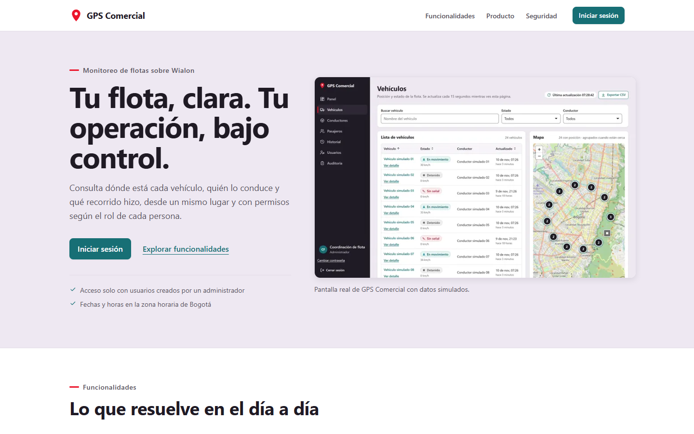
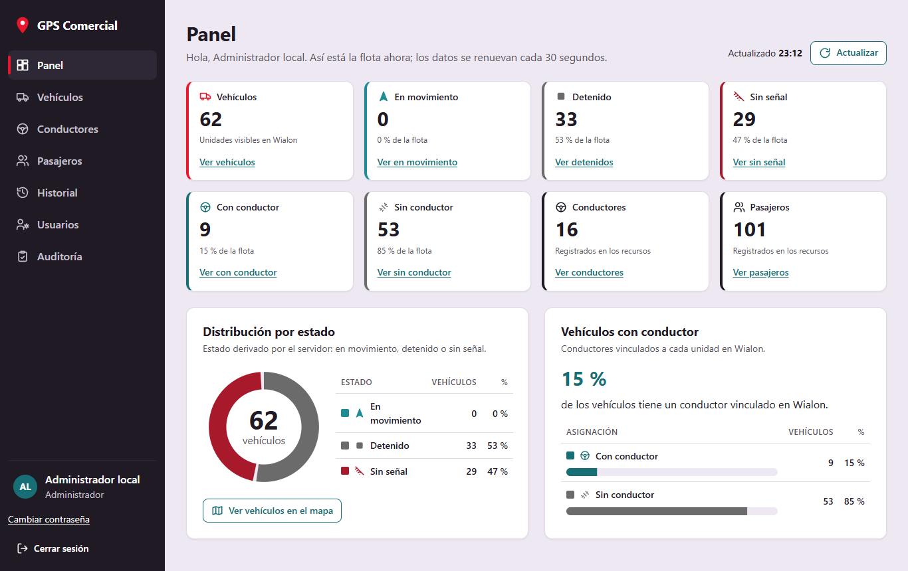
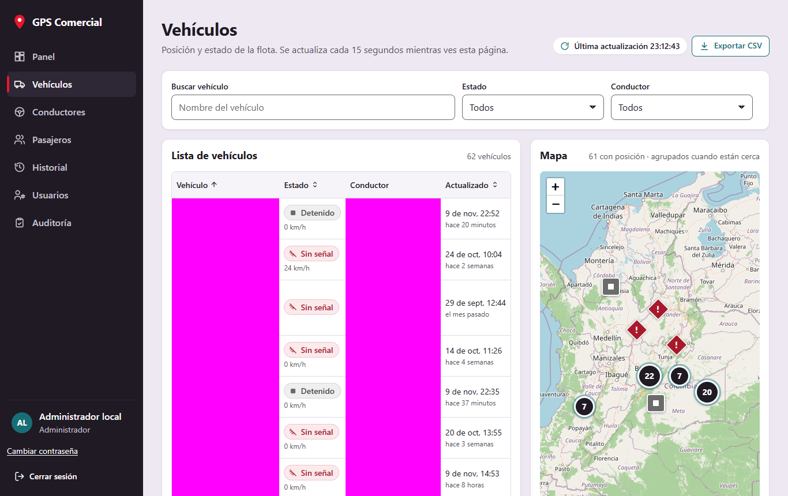
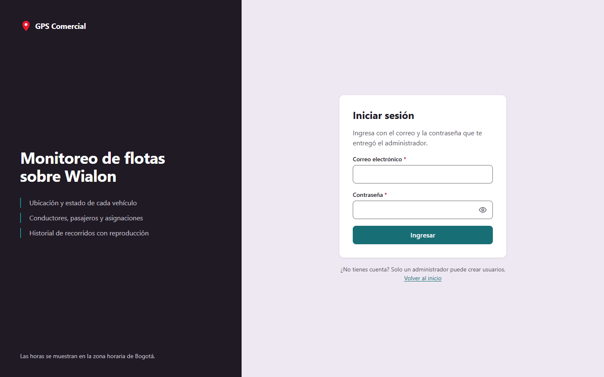
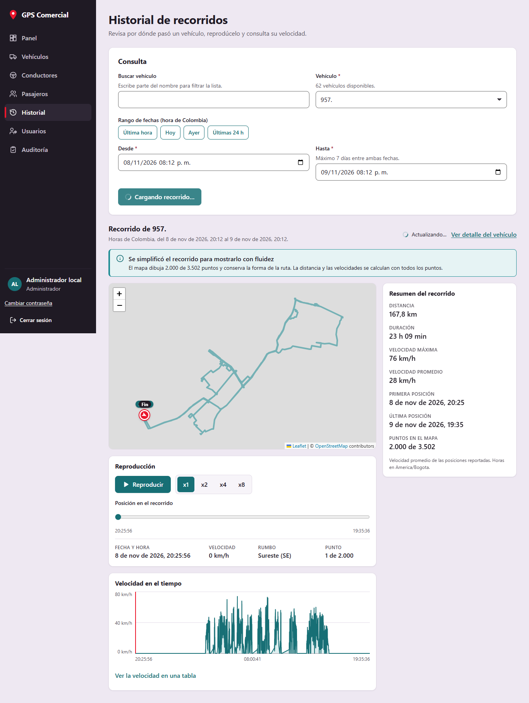
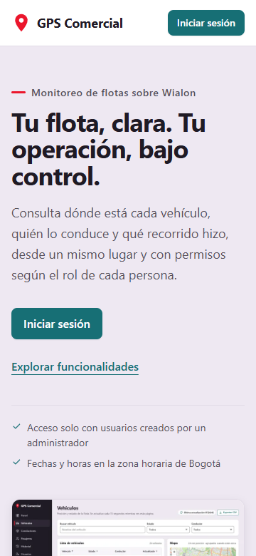
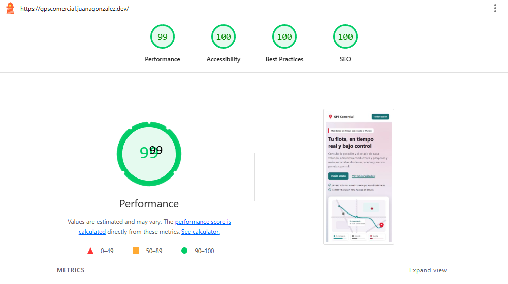
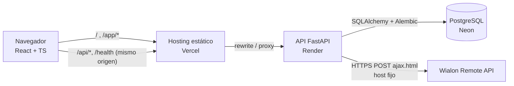
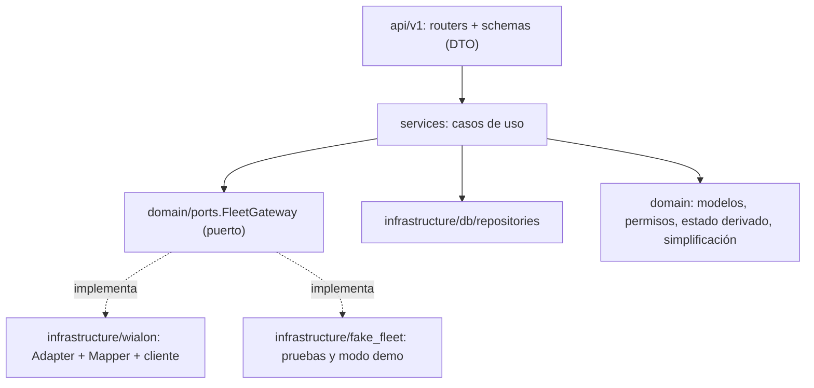

# GPS Comercial

Plataforma web de monitoreo de flota conectada a **Wialon**. Incluye:
- mapa en vivo y vehículos;
- conductores y pasajeros con asignaciones y campos personalizados;
- historial de recorridos con reproducción;
- dashboard, exportación CSV y auditoría;
- control de acceso por roles: Administrador, Operador y Visualizador.

Prueba técnica Fullstack para GPS Control. Backend en **FastAPI (Python 3.13)**; frontend en **React 19 + TypeScript + Vite**; base **PostgreSQL**.

El estado verificado de cada requisito, con evidencia, está en [docs/checklist.md](docs/checklist.md). El relevo de trabajo está en [docs/estado.md](docs/estado.md).

## 1. Capturas
Capturas reales tomadas con Playwright y Chrome. Las de la landing muestran la aplicación con datos simulados; las demás usan la cuenta Wialon `demoApps`. Por privacidad, los nombres o
IMEI de los vehículos, los conductores y el mapa del recorrido aparecen **enmascarados** en magenta. El mapa general se
muestra a escala de país.

| Landing | Dashboard | Vehículos: lista y mapa con clustering |
|---|---|---|
|  |  |  |

| Login | Historial con reproducción y velocidad | Móvil 360 px: landing |
|---|---|---|
|  |  |  |

**Lighthouse móvil** sobre la URL de producción `https://gpscomercial.juanagonzalez.dev` (2026-11-10, dos ejecuciones con el
mismo resultado):

| Rendimiento | Accesibilidad | Buenas prácticas | SEO | LCP | TBT | CLS |
|---|---|---|---|---|---|---|
| **99** | **100** | **100** | 100 | 1,7 s | 20 ms | 0 |



## 2. Enlaces
| Recurso | URL |
|---|---|
| Aplicación (frontend) | https://gpscomercial.juanagonzalez.dev (alternativa: https://gps-comercial.vercel.app) |
| API | https://gps-comercial-ygq0.onrender.com (`/health`) |
| Swagger / OpenAPI | https://gps-comercial-ygq0.onrender.com/docs y `/openapi.json` |
| Repositorio | https://github.com/JuanaGonzalez21/gps-comercial |

**Despliegue:**

| Pieza | Servicio |
|---|---|
| Frontend | Vercel Hobby |
| API | Render Free (Docker, región Virginia) |
| Base de datos | Neon Free (PostgreSQL, AWS us-east-1) |

- Ninguno de los tres planes requiere tarjeta ni caduca.
- Procedimiento completo en [docs/deploy-guide.md](docs/deploy-guide.md).
- Las credenciales de Administrador se entregan por correo privado, nunca en el repositorio.

**Comprobado en producción (2026-11-10):**
- HTTPS con HSTS y cabeceras de seguridad (CSP, `nosniff`, `X-Frame-Options`, `Referrer-Policy`, `Permissions-Policy`) en los dos dominios del frontend y en la API.
- Vercel reenvía `/api/*` y `/health` a Render sin caché (`x-vercel-cache: MISS`, `Cache-Control: no-store`).
- Las rutas directas (`/app/vehicles`, `/login`) cargan la aplicación y los recursos estáticos se sirven tal cual.
- CORS y CSRF: un `POST` con `Origin` ajeno → 403 `csrf_failed`, porque Vercel reenvía el `Origin`. Sin sesión → 401.
- Neon conectado: migraciones aplicadas al arrancar y Admin creado desde las variables de Render.
- La autora confirmó en el navegador el login, la consulta de flota y la edición.
- Lighthouse móvil: 99/100/100/100.
- Arranque tras inactividad: el aviso "Iniciando el servidor" y los reintentos están probados en local. La medición en producción del 2026-11-10 encontró el servicio ya activo (`/health` en 1,0 s), así que no se observó un arranque en frío real; se comprueba abriendo la web tras 15 min sin uso.
- Prueba autenticada de solo lectura `e2e/production.spec.ts` (cookies `HttpOnly`/`Secure`/`SameSite=Lax`, CSRF, refresh, datos reales, rutas directas, logout y, opcionalmente, rol Visualizador): la ejecuta la autora con sus credenciales en su terminal.

## 3. Ejecutar en local
Requisitos:
- Git.
- Node.js 22.12+ o 24.x.
- [uv](https://docs.astral.sh/uv/getting-started/installation/) 0.11+, que instala Python 3.13 según `backend/.python-version`.

### Backend
```bash
cd backend
cp .env.example .env          # Windows PowerShell: Copy-Item .env.example .env
# Edita backend/.env: WIALON_TOKEN, JWT_SECRET, ADMIN_EMAIL, ADMIN_PASSWORD, ADMIN_FULL_NAME
uv sync --locked
uv run alembic upgrade head   # SQLite local por defecto; PostgreSQL con DATABASE_URL=postgresql://...
uv run python -m app.cli seed-admin
uv run uvicorn app.main:app --reload --port 8000
```
Sin token de Wialon, la interfaz puede trabajarse con `FLEET_GATEWAY=fake`. Los datos son **simulados**, la UI muestra el aviso "Datos simulados" y la configuración lo rechaza en producción.

### Frontend
```bash
cd frontend
npm ci
npm run dev                   # http://localhost:5173; /api y /health van por proxy al backend
```

### Docker (alternativa)
`docker compose up --build` levanta PostgreSQL 17, la API y el frontend (ver `docker-compose.yml`).

### Pruebas y auditoría
```bash
cd backend  && uv run pytest && uv run ruff check . && uv run pip-audit   # cobertura: uv run pytest --cov=app
cd frontend && npm run build && npm run lint && npm test && npm audit
cd frontend && npx playwright test   # e2e reales: requiere backend + Vite y E2E_EMAIL/E2E_PASSWORD
```
Pruebas bajo demanda contra producción (sin escrituras):
- `E2E_PRODUCTION=1 E2E_BASE_URL=https://gpscomercial.juanagonzalez.dev npx playwright test e2e/production.spec.ts`
- `E2E_COLDSTART=1 E2E_BASE_URL=… npx playwright test e2e/coldstart.spec.ts`, después de 15 min sin tráfico.
- `E2E_SCREENSHOTS=1 npx playwright test e2e/screenshots.spec.ts` regenera las capturas enmascaradas del README.

Scripts contra Wialon real (necesitan `WIALON_TOKEN` en `backend/.env`):
- `uv run python scripts/wialon_probe.py`: solo lectura. Imprime conteos, claves JSON y permisos, nunca secretos.
- `uv run python scripts/wialon_write_check.py`: crea, edita, vincula y borra **solo** datos de prueba propios (`ZZ-PRUEBA-GPS-COMERCIAL`) y verifica que no queden restos.

### Variables y secretos
| Archivo | ¿Se versiona? | Contenido |
|---|---|---|
| `backend/.env.example`, `frontend/.env.example` | Sí | Nombres de todas las variables, sin valores secretos |
| `backend/.env` | **No** | Token de Wialon, `JWT_SECRET`, Admin inicial |

Todo `VITE_*` acaba en el JavaScript público, así que el frontend no guarda secretos.

Las variables están documentadas en [docs/api-contract.md §8](docs/api-contract.md).

## 4. Arquitectura



El navegador solo habla con el dominio del frontend. Vercel reescribe `/api/*` hacia la API, de modo que las cookies de sesión son de primera parte; en local, Vite hace lo mismo con su proxy.

Capas del backend (`backend/app`):


Frontend (`frontend/src`):

| Carpeta | Contenido |
|---|---|
| `api/` | Cliente HTTP centralizado y hooks de TanStack Query por dominio |
| `auth/` | Sesión (`useAuth`) |
| `app/` | Router, guards y avisos globales |
| `ui/` | Sistema de componentes |
| `features/<dominio>/` | Pantallas de cada dominio |
| `map/` | Leaflet y clustering |
| `lib/` | Formatos en America/Bogota |

Modelo de datos local. Los vehículos, conductores y pasajeros viven en Wialon y no se copian; solo hay una caché en memoria con TTL de 15 s.
```mermaid
erDiagram
  roles ||--o{ users : tiene
  roles ||--o{ role_permissions : concede
  permissions ||--o{ role_permissions : ""
  users ||--o{ auth_sessions : abre
  users ||--o{ audit_logs : realiza
  users { uuid id PK; string email UK; string password_hash; bool is_active; bool must_change_password; int failed_login_attempts; timestamptz locked_until }
  roles { int id PK; string code UK; string name }
  permissions { int id PK; string code UK; string description }
  auth_sessions { uuid id PK; string refresh_token_hash UK; string previous_refresh_token_hash; timestamptz expires_at; timestamptz revoked_at }
  audit_logs { bigint id PK; timestamptz occurred_at; string actor_email; string action; string entity_type; string entity_id; string outcome; string ip_address; json details }
```

## 5. Decisiones de arquitectura (patrones y SOLID con referencias)
| Patrón | Dónde | Por qué |
|---|---|---|
| **Adapter / Gateway** | `backend/app/infrastructure/wialon/gateway.py:125` (`WialonFleetGateway`) implementa `backend/app/domain/ports.py:28` (`FleetGateway`) | El resto del sistema no conoce Wialon: servicios y pruebas usan el puerto |
| **DTO / Mapper** | Wialon → dominio en `infrastructure/wialon/mappers.py:53` y `:80`, validado antes por `schemas.py`. Dominio → JSON propio en `api/schemas/vehicles.py:76` (`from_view`) | Nunca se devuelve JSON crudo de Wialon (INT-04) |
| **Repository** | `infrastructure/db/repositories.py:37` (`UserRepository`), `:88` y `:122` | Todo el SQL local en un sitio, con consultas parametrizadas por el ORM |
| **Inyección de dependencias** | `api/deps.py:70` y `:121`; `main.create_app(settings, fleet_gateway=..., session_factory=...)` | Las pruebas sustituyen gateway, base y servicios sin parches |
| **Strategy** | `domain/vehicle_status.py:17` (`StatusPolicy`) y `:22` (`ThresholdStatusPolicy`) | La regla de estado se puede cambiar sin tocar a quien la usa |
| **Factory** | `main.py:26` (`build_fleet_gateway`) | Elige el adaptador real o el simulado según la configuración |

**SOLID:**
- **S, responsabilidad única:**
  - `client.py:41` solo transporte y sesión;
  - `gateway.py:125` solo traducción a dominio;
  - `services/vehicle_service.py:34` solo reglas de listado.
- **O, abierto/cerrado:** los permisos son datos (`domain/permissions.py:78`, sembrados en la migración), no `if role == ...`. Una regla de estado nueva es otra implementación de `StatusPolicy`.
- **L, sustitución de Liskov:** `FakeFleetGateway` (`fake_fleet/gateway.py:35`) y `WialonFleetGateway` son intercambiables detrás de `FleetGateway`. La misma batería de endpoints corre sobre el simulado.
- **I, segregación de interfaces:** los casos de uso de flota dependen de `AuditSink` (`services/audit_service.py:84`), que solo expone `record`, no del servicio de auditoría completo.
- **D, inversión de dependencias:** `VehicleService`, `DriverService` y `PassengerService` reciben el puerto `FleetGateway` por constructor. `deps.py` decide la implementación.

**Otras decisiones:**
- **Endpoints síncronos** sobre el threadpool de FastAPI: código más simple de depurar para el volumen de la prueba.
- **Escrituras sobre datos frescos:** la lectura previa invalida la caché (`FleetGateway.refresh`) y se reenvía el objeto completo, porque Wialon borra los campos opcionales omitidos.
- **Vinculaciones con confirmación:** Wialon las aplica de forma asíncrona (unos 2 s, medido en la cuenta real). El backend relee con un límite de 8 intentos u 8 s (`gateway.py:182`). Si no se confirma, responde un error explícito, nunca un falso éxito.
- **Historial:** se cargan hasta 20.000 mensajes con `messages/load_interval` y se libera la sesión con `messages/unload`. Se simplifica con Ramer–Douglas–Peucker a 2.000 puntos como máximo (`domain/track.py:79`); las estadísticas usan todos los puntos.
- **Frontend:**
  - cliente único (`frontend/src/api/client.ts:95`) con CSRF, refresh compartido entre peticiones y reintentos de arranque en frío solo para GET;
  - estado de servidor con TanStack Query y polling de 15 s pausado con la pestaña oculta;
  - guards de ruta (`frontend/src/app/guards.tsx:13`, `:41`).

## 6. Seguridad (OWASP Top 10 2021) y modelado de amenazas
| ID | Controles implementados (y probados) |
|---|---|
| SEG-01 Control de acceso | <ul><li>RBAC con permisos en base de datos y `require_permission` en cada endpoint (`api/deps.py:121`).</li><li>Una prueba recorre todas las rutas: 401 anónimo y 403 sin permisos.</li><li>Matriz por rol en `tests/test_role_matrix.py`.</li><li>Los ids remotos solo se aceptan si la cuenta Wialon los ve (404 si no).</li><li>CORS con orígenes explícitos.</li></ul> |
| SEG-02 Criptografía | <ul><li>Argon2id con perfil OWASP (19 MiB, t=2, p=1) y concurrencia acotada.</li><li>Cookies `HttpOnly`, `Secure` en producción y HSTS.</li><li>Ningún token en `localStorage`, URLs ni logs.</li></ul> |
| SEG-03 Inyección | <ul><li>ORM con parámetros.</li><li>Pydantic valida toda entrada con mensajes en español.</li><li>React escapa la salida, sin `innerHTML`.</li><li>CSV con prefijo `'` en celdas que empiezan por `= + - @`, tabulador o retorno de carro (`services/export_service.py:34`).</li></ul> |
| SEG-04 Diseño | Modelado de amenazas (tabla siguiente); mínimo privilegio (Visualizador sin escrituras ni exportación) |
| SEG-05 Configuración | <ul><li>Cabeceras: CSP `default-src 'none'` en la API y CSP estricta en Vercel, `nosniff`, `X-Frame-Options`, `Referrer-Policy`, `Permissions-Policy` y COOP (`core/security_headers.py:15`).</li><li>Sin credenciales por defecto.</li><li>En producción se exige `JWT_SECRET`, PostgreSQL y orígenes `https://`, y se prohíben los datos simulados.</li><li>Swagger deshabilitado por defecto en producción; ver el supuesto de la sección 9.</li></ul> |
| SEG-06 Dependencias | <ul><li>`uv.lock` y `package-lock.json` fijados.</li><li>`pip-audit` → "No known vulnerabilities found" y `npm audit` → 0 vulnerabilidades (2026-11-09).</li></ul> |
| SEG-07 Autenticación | <ul><li>Límite de 10 intentos por minuto y por IP (429 + `Retry-After`).</li><li>Bloqueo de 15 min tras 5 fallos con contador atómico.</li><li>Mensaje genérico y tiempo constante.</li><li>Política de contraseñas.</li><li>Access JWT de 15 min y refresh rotatorio con detección de reutilización.</li><li>El logout revoca la sesión aunque el access haya caducado.</li><li>Desactivar un usuario corta su acceso en la siguiente petición.</li><li>Cambio obligatorio de la contraseña inicial.</li></ul> |
| SEG-08 Integridad | <ul><li>Lockfiles.</li><li>Las respuestas de Wialon se validan con modelos Pydantic antes de mapearlas; los elementos inválidos se descartan sin romper la respuesta.</li></ul> |
| SEG-09 Registro | <ul><li>Auditoría persistente de logins fallidos, accesos denegados, usuarios, conductores, pasajeros, campos, asignaciones y exportaciones.</li><li>Logs JSON con `request_id` y redacción de secretos.</li><li>SQLAlchemy con `hide_parameters`.</li></ul> |
| SEG-10 SSRF / excepciones | <ul><li>Un único host de Wialon fijado por configuración.</li><li>Los errores 500 devuelven Problem Details con `request_id`, sin trazas.</li><li>Wialon caído → 503 con `Retry-After`.</li></ul> |
| SEG-11 CSRF | <ul><li>Patrón double-submit (`gc_csrf` + `X-CSRF-Token`) y lista blanca de `Origin` en todo método no seguro (`api/deps.py:81`).</li><li>`SameSite=Lax`.</li></ul> |

| Amenaza | Mitigación |
|---|---|
| Robo del token de Wialon | Solo vive en el backend (variable de entorno). Nunca sale en respuestas, logs ni URLs, y las llamadas a Wialon van por POST |
| Fuerza bruta / credential stuffing | Límite por IP, bloqueo por cuenta, Argon2id, mensajes genéricos |
| Escalada de privilegios desde la UI | El backend valida cada permiso. El frontend solo oculta acciones |
| CSRF con cookies de sesión | Token double-submit, `Origin` y `SameSite=Lax` |
| Robo de cookie de refresh | `HttpOnly`, ruta `/api/v1/auth`, rotación y revocación si se reutiliza un token rotado |
| Pérdida de datos remotos al editar | Se lee fresco y se reenvía el objeto completo (`jp` incluido). Verificado contra Wialon real |
| Escrituras repetidas con resultado incierto | No se reintentan. El error indica revisar antes de repetir |
| CSV injection | Neutralización de celdas peligrosas |
| Fuga de información en errores | Problem Details sin internos y logs redactados |

## 7. Decisiones de diseño
Documento completo, con la tabla de contraste medida: [docs/design-system.md](docs/design-system.md).

| Color | Rol | Contraste y uso |
|---|---|---|
| `#EEE8F2` | Fondo de la aplicación | Solo con texto oscuro `#1F1A24` (14,18:1) |
| `#EB162C` | Marca y acento: logo, indicador activo, anillo de foco de 3 px | 4,48:1 sobre blanco. Solo elementos no textuales o texto grande |
| `#A81A2B` | Peligro, error y "Sin señal" | Texto blanco 7,37:1. Las acciones destructivas usan este color y nunca el primario |
| `#1E8C93` | "En movimiento", éxito, iconos y marcadores | Los botones primarios usan su derivado oscuro `#176F75` (blanco 5,89:1) |
| `#6B6B6B` | Texto secundario sobre blanco (5,33:1) y "Detenido" | — |

**Jerarquía y estados:**
- Cada estado combina **icono + texto + color**, e incluso forma de marcador distinta en el mapa: círculo con flecha, cuadrado y rombo con "!".
- Así nunca depende solo del color.

**Accesibilidad y adaptación a pantallas:**
- Contraste AA.
- Foco visible y enlace "Saltar al contenido".
- Etiquetas y errores asociados a cada campo.
- Diálogos nativos con el foco atrapado y devuelto al cerrar.
- Gráficas con tabla alternativa.
- Respeto de `prefers-reduced-motion`.
- Diseño mobile-first: en 360 px las tablas se convierten en tarjetas y el mapa alterna con la lista.

## 8. Transformación de datos de Wialon
**Conversiones:**
- Timestamps UNIX → ISO-8601 UTC con `Z` en la API. La UI muestra America/Bogota (es-CO).
- Velocidad en km/h (unidad de Wialon). El rumbo se normaliza a 0–359 y la UI lo muestra como punto cardinal (N, NE, E, SE, S, SO, O, NO).
- Las coordenadas se validan: rango, valores finitos y descarte de (0,0). Los valores nulos se muestran como "Sin dato" o "Sin posición" sin romper la UI.

**Estado derivado** (`domain/vehicle_status.py`; umbrales configurables):

| Condición | Estado |
|---|---|
| Sin posición, o último mensaje con más de `VEHICLE_NO_SIGNAL_AFTER_MINUTES` (60) minutos | **Sin señal** |
| Velocidad ≥ `VEHICLE_MOVING_SPEED_KMH` (5 km/h) | **En movimiento** |
| En otro caso | **Detenido** |

**Mapeos:**

| Wialon | Modelo propio |
|---|---|
| `avl_unit` (flags `0x1`, `0x8`, `0x400`) | `Unit` → `VehicleSummary` / `VehicleMarker` / `VehicleDetail` |
| `drvrs` (`0x100`) y `bu` | `Driver` con su vehículo vinculado |
| `tags` (`0x200000`) y `jp` | `Passenger` con `custom_fields` |
| `flds` | `CustomField` |

Referencia verificada de servicios, flags, errores y permisos: [docs/wialon-api.md](docs/wialon-api.md).

## 9. Supuestos y decisiones ante ambigüedades
- **Pasajeros:** son *tags* de Wialon y no tienen descripción (`resource/update_tag` no la admite).
- **Reasignación:** si un conductor o pasajero ya está en otro vehículo, se desvincula y se vincula al nuevo. Si ya estaba en el mismo vehículo, se responde 409.
- **Recurso de destino:** sin `WIALON_DEFAULT_RESOURCE_ID`, las altas van al primer recurso que devuelve Wialon. La UI permite elegir recurso si hay varios.
- **Exportaciones:** exigen `exports:csv` **y** el permiso de lectura de la entidad. Con la matriz del enunciado coincide.
- **Usuarios:**
  - el Admin no puede desactivarse, quitarse el rol ni restablecer su propia contraseña desde la administración; usa "Cambiar contraseña";
  - los usuarios no se borran, se desactivan, para conservar la auditoría.
- **Swagger en producción:** se publica en solo lectura (`API_DOCS_ENABLED=true`). El contrato ya es público en el repositorio y cada endpoint exige sesión.
- **Uso de Vercel Hobby:** una prueba técnica personal, sin cobros, encaja en "non-commercial personal use".

## 10. Declaración de uso de IA
El proyecto se desarrolló con asistencia intensiva de **Claude Code** (modelo Claude Opus 5.5, Anthropic), bajo la dirección de la autora del repositorio. La sesión principal coordinó agentes especializados: implementación (`code-orchestrator`), UX/UI (`ux-ui`) y revisión de arquitectura y seguridad (`architecture-quality`).

La IA intervino en:
- planificación y contrato de API;
- implementación del backend y del frontend;
- pruebas unitarias y end-to-end;
- lectura de la documentación oficial de Wialon y comprobaciones contra la cuenta real;
- investigación de planes gratuitos;
- revisión de seguridad;
- esta documentación.

Los commits hechos con IA llevan la línea `Co-Authored-By: Claude`. La autora revisa el código para poder explicarlo en la defensa técnica.

## 11. Limitaciones conocidas y mejoras futuras
- **Arranque en frío:** el plan gratuito de Render duerme tras 15 min sin tráfico. La primera petición tarda alrededor de 1 minuto y la UI muestra "Iniciando el servidor"; las lecturas se reintentan solas.
- **Cuotas de los planes gratuitos** (consultadas el 2026-11-09/10):
  - Render: 750 h/mes de instancia, más que un mes completo encendida.
  - Neon: 100 CU-h por proyecto al mes; el compute se suspende tras 5 min y se reanuda en milisegundos.
  - Vercel Hobby: uso personal no comercial, 100 GB de transferencia al mes.
  - Las tres cubren con margen la disponibilidad exigida de 15 días.
- **Límite de intentos por IP:** vive en memoria del proceso; basta con una instancia. El bloqueo por cuenta está en la base de datos.
- **Cuenta demo compartida:** otros usuarios pueden modificar datos de Wialon a la vez. La caché de 15 s se invalida en cada escritura y el conflicto de edición de campos se detecta (409).
- **Historial:** el máximo es de 7 días por consulta y 20.000 mensajes. Si hay más, se avisa de que el resultado está truncado.
- **Pruebas:**
  - resultados del 2026-11-09: 247 pruebas de backend (cobertura de `app` del 94 %), 161 de frontend y 5 e2e reales con Playwright;
  - las unitarias usan Wialon simulado;
  - la integración real se comprobó con `scripts/wialon_write_check.py` y con 5 pruebas e2e;
  - falta una auditoría con lector de pantalla real.
- **Mejoras:**
  - SSE o `avl_evts` para posiciones en vivo;
  - geocercas;
  - CI con GitHub Actions;
  - cliente TypeScript generado desde OpenAPI.
