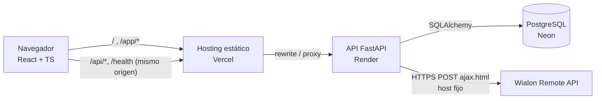
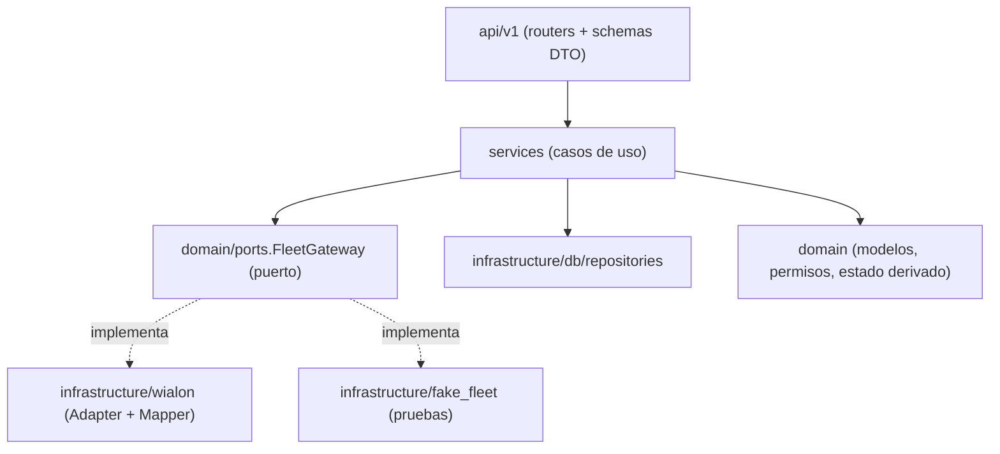

# GPS Comercial

Plataforma web de monitoreo de flota conectada a **Wialon**: mapa en vivo, vehículos, conductores, pasajeros,
historial de recorridos, dashboard, exportación CSV y auditoría, con control de acceso por roles.
Prueba técnica Fullstack para GPS Control.

> **Estado (2026-11-09):** en desarrollo. Las secciones marcadas *pendiente* se completan antes de la entrega.
> Lo verificado y lo pendiente se registra con evidencia en [docs/checklist.md](docs/checklist.md) y
> [docs/estado.md](docs/estado.md).

## 1. Capturas
*Pendiente:* landing, dashboard, mapa y vista móvil (capturas reales de la aplicación desplegada).

## 2. Enlaces
| Recurso | URL |
|---|---|
| Aplicación (frontend) | *pendiente de despliegue* |
| API | *pendiente de despliegue* |
| Swagger / OpenAPI | `<API>/docs` y `<API>/openapi.json` |

## 3. Ejecutar en local

Requisitos: Git, Node.js 22.12+ o 24.x, [uv](https://docs.astral.sh/uv/getting-started/installation/) 0.11+
(instala Python 3.13 según `backend/.python-version`).

### Backend
```bash
cd backend
cp .env.example .env          # Windows PowerShell: Copy-Item .env.example .env
# Edita backend/.env: WIALON_TOKEN, JWT_SECRET, ADMIN_EMAIL, ADMIN_PASSWORD, ADMIN_FULL_NAME
uv sync --locked
uv run alembic upgrade head   # crea/actualiza la base (SQLite local por defecto)
uv run python -m app.cli seed-admin
uv run uvicorn app.main:app --port 8000
```
Sin token de Wialon se puede trabajar la interfaz con `FLEET_GATEWAY=fake` (datos **simulados**, avisados en la UI;
prohibido en producción).

### Frontend
```bash
cd frontend
cp .env.example .env.local    # Windows PowerShell: Copy-Item .env.example .env.local
npm ci
npm run dev                   # http://localhost:5173 (proxy de /api y /health al backend)
```

### Docker (opcional)
`docker compose up --build` levanta PostgreSQL 17, la API y el frontend (ver `docker-compose.yml`).

### Comprobaciones
```bash
cd backend && uv run pytest && uv run ruff check . && uv run pip-audit
cd frontend && npm run build && npm run lint && npm test && npm audit
```
Scripts contra Wialon real (requieren `WIALON_TOKEN` en `backend/.env`):
- `uv run python scripts/wialon_probe.py`: solo lectura; imprime conteos, claves y permisos, nunca secretos.
- `uv run python scripts/wialon_write_check.py`: crea, edita, vincula y borra **solo** datos de prueba propios
  (`ZZ-PRUEBA-GPS-COMERCIAL`), sin dejar restos.

### Secretos
| Archivo | ¿Se versiona? | Contenido |
|---|---|---|
| `backend/.env.example`, `frontend/.env.example` | Sí | Nombres de variables, sin valores secretos |
| `backend/.env` | **No** | Token de Wialon, `JWT_SECRET`, credenciales del Admin inicial |
| `frontend/.env.local` | **No** | Configuración pública local |

Todo `VITE_*` acaba en el JavaScript público: el frontend no contiene secretos. Variables documentadas en
[docs/api-contract.md §8](docs/api-contract.md).

## 4. Arquitectura



Capas del backend (`backend/app`):


Modelo de datos local (los vehículos, conductores y pasajeros viven en Wialon y no se copian):
```mermaid
erDiagram
  roles ||--o{ users : tiene
  roles ||--o{ role_permissions : concede
  permissions ||--o{ role_permissions : ""
  users ||--o{ auth_sessions : abre
  users ||--o{ audit_logs : realiza
  users { uuid id PK; string email UK; string password_hash; bool is_active; bool must_change_password }
  auth_sessions { uuid id PK; string refresh_token_hash UK; timestamptz expires_at; timestamptz revoked_at }
  audit_logs { bigint id PK; timestamptz occurred_at; string action; string outcome; json details }
```

## 5. Decisiones de arquitectura
*Pendiente de completar con referencias exactas (archivo y línea) al cerrar el código.* Resumen:
- **Adapter/Gateway**: `FleetGateway` (puerto) e implementación `WialonFleetGateway`; el resto del sistema no conoce Wialon.
- **DTO/Mapper**: `infrastructure/wialon/mappers.py` (Wialon → dominio) y `api/schemas/*` (dominio → JSON propio).
- **Repository**: `infrastructure/db/repositories.py`.
- **Inyección de dependencias**: `api/deps.py` y `create_app(...)` permiten sustituir gateway y base en pruebas.
- **Strategy**: `domain/vehicle_status.StatusPolicy` (reglas de estado intercambiables).
- **Factory**: `main.build_fleet_gateway` elige el adaptador según la configuración.
- Endpoints síncronos sobre el threadpool de FastAPI: código más simple de depurar para el volumen de la prueba.

## 6. Seguridad
*Pendiente: tabla completa por categoría OWASP y modelado de amenazas.* Controles ya implementados y probados:
sesión en cookies `HttpOnly` + `SameSite=Lax` (+ `Secure` en producción), access JWT de 15 min y refresh rotatorio
con detección de reutilización, CSRF double-submit + lista de `Origin`, Argon2id, bloqueo tras 5 fallos y límite por IP,
mensajes genéricos de login, RBAC granular con denegación por defecto (prueba que recorre todas las rutas), auditoría de
accesos denegados y logins fallidos, logs JSON con redacción de secretos, cabeceras de seguridad, CORS explícito, host de
Wialon fijo (sin SSRF) y errores RFC 7807 sin detalles internos.

## 7. Decisiones de diseño
*Pendiente (paleta, jerarquía, estados semánticos y contraste).* Roles iniciales y contrastes medidos:
[docs/api-contract.md §9](docs/api-contract.md).

## 8. Transformación de datos
- Timestamps UNIX → ISO-8601 UTC con `Z` en la API; la UI muestra America/Bogota (es-CO).
- Velocidad en km/h (unidad de Wialon); rumbo normalizado 0–359 y mostrado como punto cardinal en la UI.
- Coordenadas validadas (rango, finitas, se descarta (0,0)); datos inválidos se omiten sin romper la respuesta.
- Estado derivado (`domain/vehicle_status.py`, umbrales por entorno):
  sin posición o último mensaje con más de `VEHICLE_NO_SIGNAL_AFTER_MINUTES` (60) → **Sin señal**;
  velocidad ≥ `VEHICLE_MOVING_SPEED_KMH` (5) → **En movimiento**; resto → **Detenido**.
- Referencia de Wialon verificada (flags, servicios, errores, permisos): [docs/wialon-api.md](docs/wialon-api.md).

## 9. Supuestos y decisiones ante ambigüedades
- Los pasajeros son *tags* de Wialon; no tienen descripción (`resource/update_tag` no la admite).
- Las vinculaciones de Wialon se aplican de forma asíncrona (~2 s): el backend confirma releyendo antes de responder.
- Frontend y API se sirven bajo un mismo origen (rewrite del hosting) para que las cookies sean de primera parte.

## 10. Declaración de uso de IA
Este proyecto se desarrolló con asistencia intensiva de **Claude Code** (modelo Claude Opus 5.5, Anthropic) bajo la
dirección de la autora del repositorio: planificación, contrato de API, implementación del backend y del frontend,
pruebas, investigación de la documentación de Wialon y de los planes gratuitos de hosting, y redacción de esta
documentación. La autora revisa el código para poder explicarlo en la defensa técnica.
Los commits generados con IA llevan la línea `Co-Authored-By: Claude`. *Pendiente: detalle final por módulo.*

## 11. Limitaciones conocidas y mejoras futuras
*Pendiente de completar al cierre.* Por ahora: el límite de intentos por IP vive en memoria del proceso (una instancia);
el arranque en frío del plan gratuito de Render tarda ~1 minuto.
